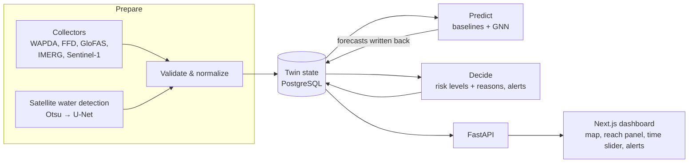

# Architecture

This document describes the high-level structure of Darya and the rules that should rarely change.
- For the step-by-step order of operations, see `docs/FLOW.md`.
- For data sources, see `docs/DATA.md`.
- Items marked *(planned)* are not decided yet. See `docs/DECISIONS.md`.

## Bird's-eye view
Darya is a **digital twin** of the Indus river system. In this project that means three things:
1. Darya keeps a computer model of the river network.
2. The model is **regularly updated from real observations** and **keeps every past state**.
3. The model is used to **forecast the next 1–3 days**.

The dashboard is only one way of looking at the twin.



Every stage is a separate module that shares **one database and one backend**. Adding a new river or data source should mean adding a collector and some graph nodes, not redesigning the system.

## Core concepts
| Concept | Meaning |
|---|---|
| **Node** | A point of interest: a dam, barrage, headworks, gauge or confluence. It has a stable slug id (e.g. `tarbela`), a river and a location |
| **Reach** | The stretch of river between two consecutive nodes. It is the basic unit of the twin |
| **River graph** | A directed graph of nodes and reaches running upstream → downstream. It has about two dozen nodes |
| **Observation** | One measured value (level, inflow, outflow, rainfall, …) for a node or reach. It carries its `source`, `observed_at`, `ingested_at`, unit and quality flags |
| **WaterExtent** | Water area and flooded area per reach, taken from one satellite scene, plus the change since the previous scene |
| **Twin state** | The latest known value of everything about a reach, each value with its timestamp. Every update creates a new version, so the full history is kept |
| **ForecastRun / Forecast** | One run of one model at issue time *t*, producing per-node values for lead times of 1–3 days with an uncertainty range |
| **RiskAssessment** | A forecast mapped to a flood category (Normal, Low, Medium, High, Very High, Exceptional) together with its main **reasons** |
| **Alert** | Raised by a simple rule, e.g. a forecast crossing a flood category. Listed on the dashboard |

### Planned river graph (main channels)
```
Indus : Tarbela → Ghazi Barotha → Jinnah → Chashma → Taunsa → Guddu → Sukkur → Kotri
Kabul : Warsak → Nowshera → (joins Indus between Ghazi Barotha and Jinnah)
Jhelum: Mangla → Rasul → Trimmu
Chenab: Marala → Khanki → Qadirabad → Trimmu → Panjnad
Ravi  : Balloki → Sidhnai → Panjnad
Sutlej: Sulemanki → Islam → Panjnad
Panjnad → (joins Indus between Taunsa and Guddu)
```
Link canals transfer water between rivers, e.g. Chashma-Jhelum, Taunsa-Panjnad and Rasul-Qadirabad. They may be added later as extra edges. Node coordinates are in `docs/DATA.md`.

## Codemap
<!-- Update this as code lands. Name modules; don't hyperlink (links rot). -->
- **`app/backend`**: FastAPI service. The layout is organised by domain (see `app/backend/CLAUDE.md`).
  - `ingest/<source>`: one collector per source. Each fetches raw data, stores it unchanged, then parses and validates it.
  - `twin`: node, reach and graph models, plus versioned state updates.
  - `forecast`: baselines (persistence, historical mean, regression), LSTM and GNN *(planned: PyTorch + PyG)*.
  - `risk`: maps values to flood categories, generates reasons and applies alert rules.
  - `api`: routers and Pydantic schemas. Its OpenAPI output is the contract with the frontend.
- **`app/frontend`**: Next.js dashboard (see `app/frontend/DESIGN.md`).
- **Satellite processing** *(planned)*: Sentinel-1 preprocessing and water masks. This runs as batch scripts or worker jobs, not inside request handlers.

## Invariants
- **The frontend talks only to the FastAPI API.** It never connects to the database or to external sources.
- **Raw data is immutable.** Collectors store what they downloaded exactly as received. All fixes happen in derived tables.
- **Twin history is append-only.** An update adds a new version and never overwrites an old one.
- **No future leakage.** A forecast or backtest made at time *t* may only use data with `available_at ≤ t`. This is why `ingested_at` and availability times are kept.
- **Every value shown has a timestamp and a unit.** The UI always shows how recent and how certain a value is.
- **Models must beat baselines.** The GNN is reported against persistence, historical mean, regression and LSTM, all evaluated on the held-out 2022 and 2025 seasons.
- **Darya is not an official warning system.** Risk levels follow the FFD categories but are labelled as research-prototype output.

## Deployment *(planned)*
- Docker Compose with three containers: `db` (PostgreSQL, PostGIS planned), `backend` (FastAPI and scheduled jobs) and `frontend` (Next.js). The whole system starts with one command.
- Hosting: one Linux machine with about 4 cores, 8 GB RAM and around 200 GB of storage.
- GPU time for training comes from the university or Colab.
- An external disk holds the satellite archive.
