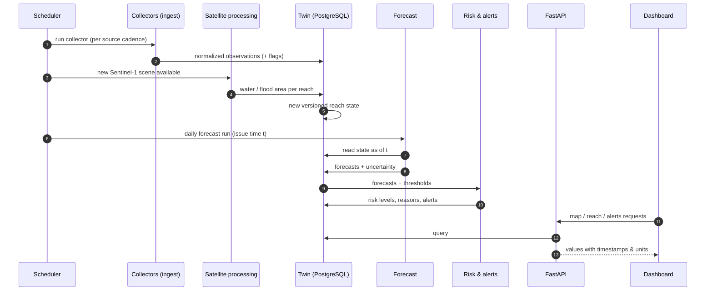

# Flow of operations

This file traces how every operation in Darya runs, from raw data to what the user sees. For each step it gives the trigger, the input, the output and the module responsible.
Everything here is **planned**. As steps get implemented, update them with real job names, schedules, tables and endpoints.

## A. Ingestion (scheduled, per source)
| # | Step | Detail |
|---|---|---|
| A1 | Trigger | The scheduler runs each collector on that source's cadence. FFD and IRSA are daily. IMERG runs every few hours. GloFAS is daily. **WAPDA is a one-time historical load, run by hand:** `python -m scripts.ingest_wapda` from `apps/backend` (add `--dry-run` to only write `data/wapda/processed/review.csv`). |
| A2 | Fetch | Download the new data and store it **unchanged** in the raw area, recording source, URL or file and fetch time. |
| A3 | Parse | Turn the source format (xls, PDF, HTML, NetCDF, GRIB) into a DataFrame of records. WAPDA: `ingest/wapda/sheet_finder.py` and `sheet_parser.py`, rules in `docs/DATA.md`. |
| A4 | Validate | Check the date, unit and range, plus cross-checks such as total outflow = turbine + other. Flag problems; don't silently drop records. WAPDA: `ingest/wapda/cleaning.py`. |
| A5 | Normalize | Map each record to a node id and a standard field name with its unit. Re-running must be safe: a source's loader replaces only its own rows (ADR-018). WAPDA: `ingest/wapda/load_to_db.py`. |
| A6 | Output | `daily_observations` rows with `source`, `observed_on`, `ingested_at` and `flags` (meanings in `docs/DATA.md`). |

## B. Satellite water detection (when a new Sentinel-1 scene covers the study area)
| # | Step | Detail |
|---|---|---|
| B1 | Discover | Search the catalog (CDSE, Planetary Computer, …) for new scenes over the study area. |
| B2 | Preprocess | Calibrate, filter speckle and terrain-correct the scene, or use ready-made RTC data. Then clip to a buffer around each reach. |
| B3 | Detect water | Use Otsu thresholding first. Add a U-Net trained on Sen1Floods11 later. |
| B4 | Separate floodwater | Subtract the normal channel taken from JRC Global Surface Water. |
| B5 | Output | One `WaterExtent` per reach per scene: water area, flooded area and change since the last scene. |

## C. Twin update (after A or B writes new data)
| # | Step | Detail |
|---|---|---|
| C1 | Collect | Gather the latest observations and water extents for each affected reach. |
| C2 | Version | Write a **new** state version. Keep the timestamp of every value so the UI can show how fresh it is. |
| C3 | Output | The current reach state plus its full history. Forecasts and the UI read from this. |

## D. Forecast run (daily, at issue time *t*)
| # | Step | Detail |
|---|---|---|
| D1 | Read | Read the twin **as of t**, using only data with `available_at ≤ t`. |
| D2 | Run models | Persistence, historical mean, regression, LSTM and GNN. The GNN uses the river graph. |
| D3 | Output | A `ForecastRun` with per-node values for 1–3 days ahead and an uncertainty range, written back into the twin. |

## E. Risk and alerts (after each forecast run)
| # | Step | Detail |
|---|---|---|
| E1 | Classify | Map the forecast flow to FFD flood categories (thresholds in `docs/DATA.md`). Sites without FFD limits use the normal range for that time of year. |
| E2 | Explain | Attach the main reasons, e.g. rising flow upstream, heavy recent rainfall, or level above the seasonal normal. Include the uncertainty. |
| E3 | Alert | Apply simple rules, such as a forecast crossing a category or a rapid rise, to raise or close alerts. |
| E4 | Output | `RiskAssessment` and `Alert` rows. |

## F. Serving and dashboard (on user request)
| # | Step | Detail |
|---|---|---|
| F1 | Open dashboard | The UI loads the river network, the current risk per reach and the active alerts from the API. |
| F2 | Select a reach | The reach panel shows current state, risk level, reasons, a chart of past and forecast values with an uncertainty band, and data freshness. |
| F3 | Time slider | Moves from the past, through now, to +3 days. The UI requests the state and forecasts for the selected time. |
| F4 | Alerts | The alert list links to the reaches concerned. |

## G. Offline operations (run by hand or as scripts)
| # | Operation | Detail |
|---|---|---|
| G1 | Historical backfill | Run the collectors over past dates: WAPDA archives from Jul 2022, GloFAS reanalysis from 2015, and IMERG. |
| G2 | Build the river graph | Build nodes and reaches from HydroRIVERS and the node list in `docs/DATA.md`. |
| G3 | Train | Train on past years. Keep the **2022 and 2025** flood seasons held out. |
| G4 | Backtest and evaluate | Forecasts: MAE, RMSE and NSE. Water masks: IoU, precision and recall. Alerts: precision and recall. Also run with and without the graph to measure what it adds. |
